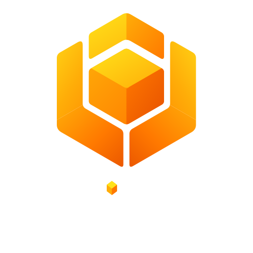

<h1 align="center">
  
</h1>

<p align="center"><strong>An ACPv2 gateway and session multiplexer for AI coding agents</strong></p>

<p align="center">
  <a href="https://github.com/noirbizarre/hive/actions/workflows/ci.yaml">
    
  </a>
  <a href="https://codecov.io/gh/noirbizarre/hive">
    
  </a>
  
  <a href="https://noirbizarre.github.io/hive/">
    
  </a>
  
</p>

---

Hive provides one ACPv2 gateway for multiple clients and manages configured
ACPv1 or ACPv2 agents behind it. One local daemon exposes the official
ACP HTTP/SSE and WebSocket transports; clients do not launch agents themselves.

The ACPv2 specification and SDK APIs are **draft**. This bootstrap is intended
for a single trusted local user, not a remotely accessible multi-user service.

## Installation

Install Rust (the pinned stable toolchain), then `mise install` for the template
tools. From a checkout, install the CLI with
`cargo install --path crates/hive-cli --bin hive`; this installs only `hive`,
not the development-only test agent. For development, build the workspace with
`mise run build` or `cargo build --workspace` and use
`cargo run -p hive-cli -- <arguments>` instead of `hive` below.

Create `$XDG_CONFIG_HOME/hive/config.toml` (or `~/.config/hive/config.toml`):

```toml
default_agent = "opencode"

[agents.opencode]
name = "OpenCode"
command = "opencode"
args = ["acp"]
versions = ["v1"] # Confirm the ACP wire version for your installation.
```

Optional price mapping requires an exact models.dev provider and model ID. For
an agent pinned to one model, add `[agents.opencode.pricing]` with
`provider = "anthropic"` and `model = "claude-sonnet-4-5"` (only if those
are the **actual billed** provider and model). For an agent exposing an ACP
model selector, use `models = { "agent-model-id" = "catalog-model-id" }`
instead of `model`. Set `cached_input_included = true` only if that agent's
reported input count includes cached reads and writes. Unmapped turns have
unknown estimated cost; catalog outages do not prevent token tracking.

The commands and version declarations are examples; check your installed
agents' ACP entrypoints and supported versions. Pi has **no native ACP mode**:
Hive reaches it through the external [`pi-acp`](https://github.com/svkozak/pi-acp)
adapter (ACPv1, tested with Pi 1.3.0 and `pi-acp` 0.0.34), which you install
yourself, for example `command = "npx"`, `args = ["-y", "pi-acp@0.0.34"]`,
`versions = ["v1"]`. See the [Pi section](docs/acp-compatibility.md#pi) and the
versioned [ACP compatibility matrix](docs/acp-compatibility.md) for launch
details, limitations and diagnostics. Adopting sessions created in Pi's own UI
is separate work ([#6](https://github.com/noirbizarre/hive/issues/6)). Profiles may also specify
`env = { KEY = "value" }`; an endpoint profile uses
`endpoint = "http://127.0.0.1:9000"` (or `ws://...`) and optional
`headers = { Authorization = "Bearer ..." }`. Keep the config file private.

To continue a conversation started in the OpenCode TUI (or resume a Hive one
there), point a profile at a running OpenCode server instead of `opencode acp`:

```toml
[agents.opencode-server]
kind = "opencode-server"
endpoint = "http://127.0.0.1:4096"          # opencode serve --port 4096
password_env = "OPENCODE_SERVER_PASSWORD"    # the variable's name, not the secret
```

List adoptable sessions with
`GET /hive/v1/providers/opencode-server/native-sessions?directory=<cwd>` and
adopt one with `session/new` and `_meta.hive.adopt = {"nativeId": "ses_…"}`. Hive
cannot lock the OpenCode client out, so it detects work the other client started
and refuses its own prompts until that finishes. Set a server password and read
[the adapter's setup, limits and security notes](docs/acp-compatibility.md#opencode-server-adapter).
No default is required to start Hive; without one, each session must select a
profile. `HIVE_DEFAULT_AGENT` overrides `default_agent`, `HIVE_CONFIG` or
`--config` chooses a different file, and `HIVE_LISTEN` overrides the loopback
listen address.

Start the daemon once in the foreground:

```sh
hive daemon
```

In another terminal run `hive daemon status`, then `hive` (or `hive tui`) to
launch the TUI. `hive web` opens the daemon-served browser client at
<http://127.0.0.1:8765/hive/v1/web>. Use `hive daemon --listen` to choose a
different loopback address and `hive daemon --config` for another profile file;
`hive daemon status --url` and `hive web --url` select a different daemon URL
(also supported by `HIVE_URL`, falling back to `HIVE_LISTEN`). Set
`hive --address` or `hive tui --address` to connect the TUI to a non-default
daemon, and `--transport http` to use HTTP/SSE instead of WebSocket. The legacy
`hive serve` and `hive status` commands remain available as aliases.

Generate shell completions with `hive completions bash` or
`hive completions zsh`, redirecting the output to your shell's completion
directory (for example, `~/.local/share/bash-completion/completions/hive` for
Bash). Run `hive completions --help` for other supported shells.

Build the Zellij plugin separately with
`cargo build -p hive-zellij --target wasm32-wasip1`, then load
`target/wasm32-wasip1/debug/hive_zellij.wasm` through Zellij's plugin loader;
grant its WebAccess and RunCommands permissions. Install the `hive` executable
in `PATH`: the plugin automatically starts `hive zellij-bridge` to hold its ACP
connection. Configure its `url` setting for a non-default loopback daemon and
`bridge` for a non-default bridge URL (default `http://127.0.0.1:8766`). The
plugin lists sessions by Hive ID; use arrows and Enter to observe, Ctrl-T to take
control, Enter to send typed text, Ctrl-C to cancel, Ctrl-H to relinquish,
Ctrl-R to retry an uncertain prompt or recover expired history, and Esc to detach. The
full-screen TUI lists sessions across directories.
Press `Ctrl-N` to create one, select a profile with the arrow keys and Enter,
then type prompts in the bottom composer. The border-light transcript and
session details follow your terminal's foreground/background and ANSI color
palette; details collapse on narrow terminals. `--agent opencode` preselects a
profile; `--session hive-…` resumes a known session. The TUI opens on a session
overview; while chatting, `Tab` shows or hides it and `Ctrl-B` returns to the
previously visited session. The overview lists sessions from all directories
by default; `a` filters to the current directory, Enter takes pilot control
and `o` attaches as an observer. `Ctrl-H` relinquishes pilot control while
continuing to observe; `Ctrl-T` takes control explicitly. `Ctrl-C` cancels
work, `Esc` quits without closing the session, and `Ctrl-R` accepts a live-only
reconnect if replay history expires. Permission requests present numbered
choices; form input accepts comma-separated `key=value` fields and URL
requests show a URL to open outside the TUI. The browser shows a session rail
by default; use "Hide sessions" / "Show sessions" to collapse or restore it
without losing the conversation. Select a recent or listed session to view its history
read-only, then type to request control before sending. Both overviews show
daemon-reported title, profile, activity, last activity and current control;
`unknown` means the agent has not reported activity, and only locally visible
pending requests are marked as needing attention. The web client offers an
agent selector before its first session. Other clients
send `session/new` with `_meta: {"hive":{"agent":"opencode"}}`, or omit it
to select the configured default. Query `/hive/v1/providers` for agent IDs.

For a key-free local smoke test, build `hive-mock-agent`, set an agent profile
with `command = "./target/debug/hive-mock-agent"` and `versions = ["v2"]`,
then run the same `hive daemon` command.

Tests: `mise run test`, `mise run cover`, and `mise run ci`. The focused
end-to-end test is `cargo test -p hive-daemon --test gateway`.
Installed-agent tests and native-session probes are opt-in; see
[real-agent compatibility probes](docs/development.md#real-agent-compatibility-probes)
and the [versioned capability matrix](docs/acp-compatibility.md#installed-agent-capability-matrix-2026-10-11).

## Documentation

<https://noirbizarre.github.io/hive/>

See [architecture](docs/architecture.md), [development](docs/development.md),
[ACP compatibility](docs/acp-compatibility.md), [transport matrix](docs/transports.md)
and [Hive API](docs/hive-api.md).

## Contributing

See [CONTRIBUTING.md](CONTRIBUTING.md).

## License

MIT — see [LICENSE](LICENSE).
