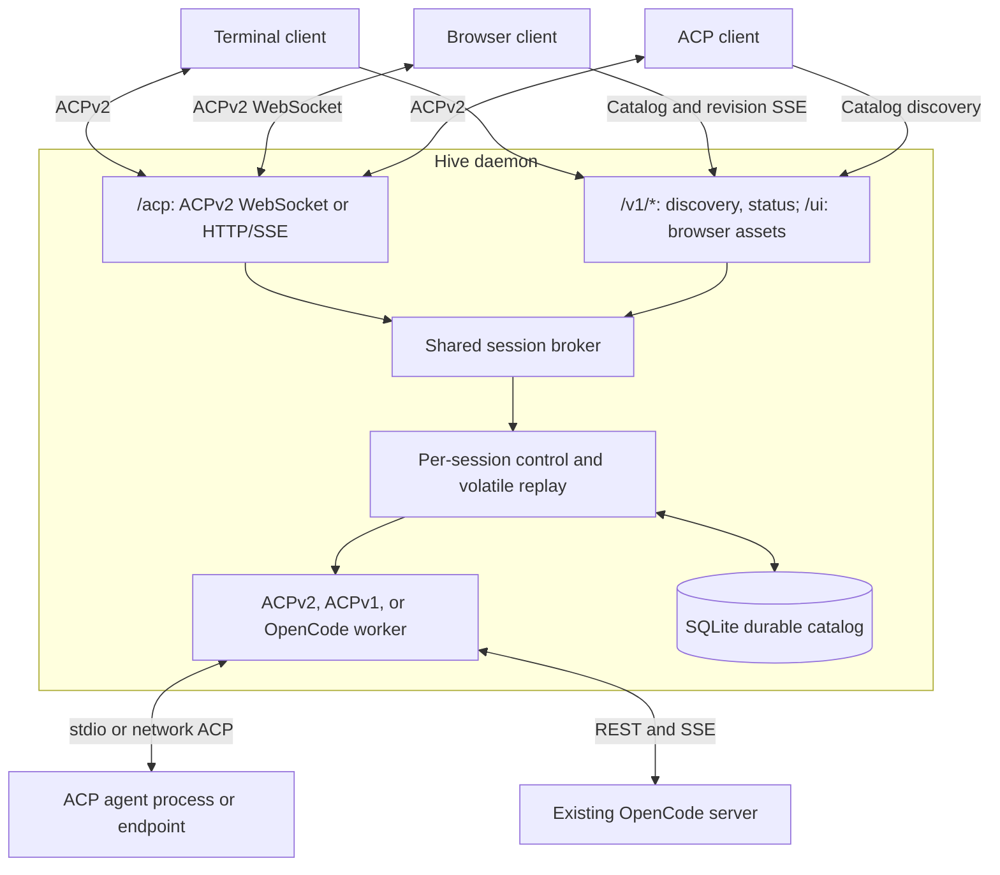
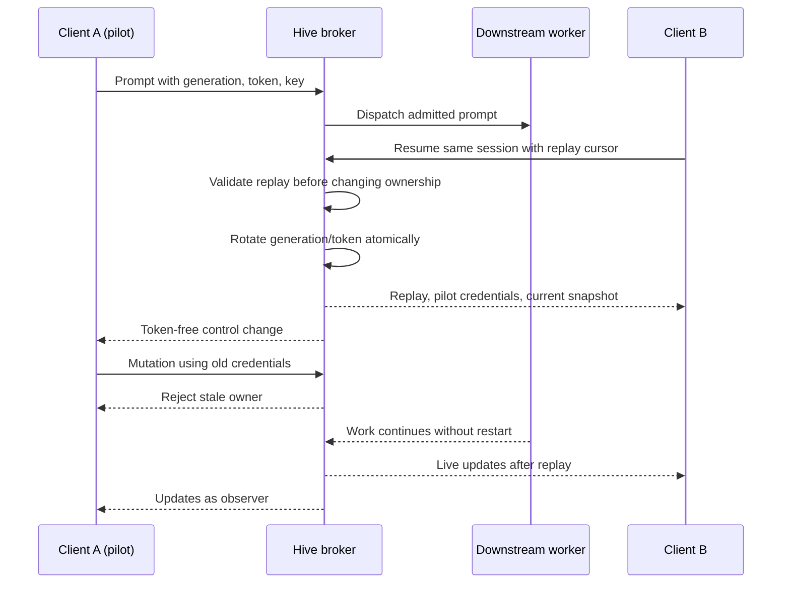

# Architecture

Hive is a local session broker with an ACPv2 gateway. The daemon owns sessions
and downstream workers. The TUI, Web UI, and other ACP clients attach to that
shared authority rather than starting independent copies of a conversation.

## System overview

The diagram separates three boundaries:

- **ACP** carries conversation, control, and agent interactions.
- **Operational HTTP** carries discovery, summaries, readiness, and assets.
- **Workers** translate the chosen downstream adapter into the shared broker contract.

Clients do not own Hive sessions. SQLite provides durable bookkeeping; the daemon
remains the session authority.

## Components and dependencies

| Component | Responsibility |
| --- | --- |
| `crates/hive-cli` | Executable, command dispatch, browser opening, doctor output |
| `crates/hive-daemon` | HTTP boundary, shared broker, workers, control, persistence, activity and usage |
| `crates/hive-core` | Transport-free Hive ID generation and declared lifecycle vocabulary |
| `crates/hive-protocol` | SDK integration, protocol version type, native interaction validation |
| `crates/hive-tui` | Terminal ACP client and UI |
| `crates/hive-mock-agent` | Deterministic development/test agent |
| `clients/hive-web` | Embedded browser assets and JavaScript ACP client |

The CLI depends on daemon and TUI libraries. Those libraries do not depend on
the CLI or each other. The operative broker lifecycle is implemented in the
daemon, not derived from the unused lifecycle vocabulary in `hive-core`.

## Session and process ownership

Four identities have different lifetimes:

1. The upstream client connection.
2. The stable Hive session ID.
3. The downstream worker/process/connection.
4. The downstream agent's session ID.

Profiles are inert configuration. Creating a session selects a profile and
starts one worker. A stdio worker owns its agent subprocess. A network worker
owns its connection, not the remote server. Each session has its own connection.

Client disconnect leaves the worker and conversation alive. Explicit close
removes the Hive record when work is idle. Daemon shutdown ends its workers but
preserves records for a later reattachment attempt.

The broker persists the downstream ID before exposing a newly registered
session. Recovery uses that saved identity rather than creating a replacement.

## Transports and worker adapters

The official SDK `AcpHttpServer` mounts `/acp`. WebSocket upgrade provides a
bidirectional JSON-RPC channel. The alternative uses HTTP POST requests and
connection/session SSE streams. Both reach the same ACPv2 handlers and broker.

ACP profiles explicitly declare versions and transport configuration. Hive
prefers v2 when declared, otherwise uses its v1 compatibility worker. There is
no speculative retry after initialization failure. V1 text and tool updates are
adapted into the v2-facing stream, with a synthetic idle transition on prompt
completion. This is bounded adaptation, not full feature equivalence.

`kind = "opencode-server"` selects the REST/SSE worker in
`crates/hive-daemon/src/opencode/`. It shares control, forwarding, replay,
interaction routing, and persistence with ACP workers. It adds native discovery
and adoption, persisted API flavor, and external-activity detection.

Duplicate adoption is guarded per profile/native ID. Hive can fence its own
clients, but cannot stop an independent OpenCode client from acting. It detects
native work and refuses its own prompts while that work is active.

See [transports](transports.md), [ADR-002](adr/002-opencode-server-adoption.md),
and [ADR-005](adr/005-explicit-downstream-protocol-compatibility.md).

## Control and handoff

Each session's synchronized control state contains the pilot connection,
generation/token, observers, active turn, prompt-key outcomes, and replay ring.
Observers receive updates but never a pilot token.

Live `session/resume` is a broker operation, not a downstream reattachment.
Replay validation, recipient registration, and takeover are serialized together.
An invalid cursor fails before ownership changes. There is no timed pilot lease.
Known disconnect releases control without stopping the downstream worker.

Prompt keys deduplicate identical logical retries. Admission is durably reserved
before dispatch. A reused key with different content fails. Acknowledgement is
not completion: foreground work ends at idle, and additional distinct prompts
are refused while busy.

See [ADR-001](adr/001-session-control-and-replay.md) and the
[exact control contract](acp-compatibility.md#control-and-replay).

## Events, replay, and snapshots

Live downstream updates pass through shared forwarding. They receive monotonically
increasing Hive sequence numbers, enter the latest-256-update ring, and fan out
to attached clients. Control, normalized activity, and usage updates also occupy
the ring. It is not 256 messages or turns.

Conversation updates also feed a separate in-memory materialized transcript,
compacting chunks into messages while retaining first-appearance order.
`replayFrom: start` sends this projection as marked snapshot entries with an
atomic high-watermark; incremental cursors still use the bounded ring.
Recovery hydrates the transcript through ACPv1 load or ACPv2 resume replay,
without repeating accounting, interactions or live broadcasts.

Atomic new/resume responses carry current activity and usage snapshots,
independently of conversation history. Clients must make unavailable history
visible before choosing live-only attachment. No durable transcript archive is maintained.

The catalog's separate SSE stream only invalidates discovery snapshots. Clients
re-list on revision changes. It is neither conversation replay nor a durable log.

## Human interactions

Session-scoped permissions and elicitation follow the current pilot.
Request-scoped elicitation follows a uniquely mapped live parent RPC to its
original requester, even after pilot transfer.

Human waits run outside SDK dispatch, so updates, other questions, and
cancellation remain responsive. Decision waits and queues are bounded. Unknown
or unsupported modes cancel safely instead of implying permission.

Rust hosts share validation helpers through `hive-protocol`. The browser has a
separate JavaScript implementation checked against shared fixtures. Forms retain
per-request drafts. Client delivery identities prevent stale answers from
answering a newer question. URL consent and completion are correlated separately.

See [ADR-007](adr/007-capability-aware-human-interaction-routing.md) and
[interaction capabilities](acp-compatibility.md#interaction-capabilities-and-fallback).

## Persistence and recovery

SQLite WAL stores the catalog at `$XDG_STATE_HOME/hive/sessions.sqlite3`, falling
back to `$HOME/.local/state/hive/sessions.sqlite3`.

| Durable | Volatile |
| --- | --- |
| Hive/downstream IDs, profile and adapter choices | Worker/process and upstream connections |
| Prompt content, reservations, and confirmed results | Conversation replay payloads |
| Recovery metadata and sequence reservations | Pilot tokens and activity snapshots |
| Usage ledger | Process-local pricing cache |

At startup, bounded reconciliation reattaches original downstream sessions where
supported. Failure leaves an explicit offline state. An interrupted prompt is
never automatically resent. Reattached uncertain work needs acknowledgement
before new prompts are admitted.

Sequence blocks are reserved durably before publication to avoid cursor reuse
after crashes. Restart can introduce gaps and loses incremental replay; transcript
snapshots are rebuilt from the downstream agent's retained history. Database
migrations use SQLite `user_version`; future schemas are refused.

See [ADR-003](adr/003-durable-session-catalog-and-conservative-recovery.md) and
[operations](operations.md) for recovery, pruning, privacy, and backups.

## Trust boundary

Production startup binds only loopback and locks a private per-user runtime
file. A second daemon cannot use another port in the same runtime namespace.
These restrictions are enforced at startup, not merely by constructing a router.

The boundary is one trusted local OS user. There is no per-client login.
Untrusted local processes able to reach the listener can access administration
and sessions. Pilot credentials fence stale clients, not hostile local users.
Downstream network endpoints have their own configuration/credential rules.

See [ADR-006](adr/006-local-operational-http-and-acp-boundary.md).
